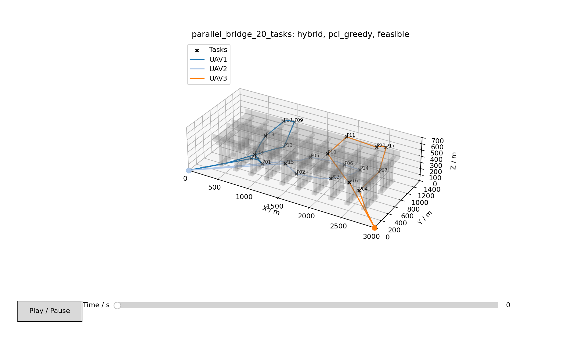
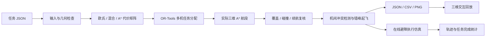
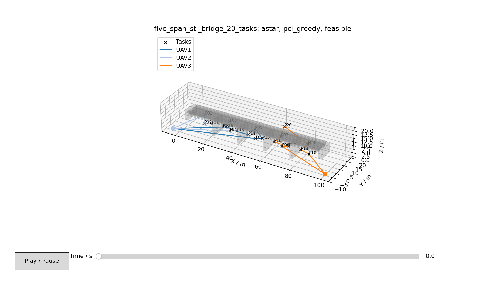

# UAV Mission Scheduling

**复杂约束下的无人机飞行任务调度建模与仿真**

[](完整代码/pyproject.toml)
[](https://github.com/xmuzr/uav-mission-scheduling/releases)

面向桥梁巡检任务的多无人机分配、三维路径规划、错峰调度与在线避障仿真项目。输入一份任务 JSON，输出各机的任务访问顺序、避障航点、起飞时刻、续航检查和执行仿真记录。



本项目提供算法与数值仿真，包含双桥、五跨 STL 梁桥和小型快速示例。坐标使用本地米制直角坐标，时间单位为秒。

## 功能

| 模块 | 实现内容 |
| --- | --- |
| 多机任务分配 | OR-Tools Routing；并行最便宜插入 + 贪心下降，支持 GLS；各机可配置不同起降点、速度和可用续航 |
| 三维避障规划 | Weighted A*、端点接入、航段复用、路径简化与碰撞复核 |
| 分配代价矩阵 | 欧氏距离、混合距离和全 A* 三种模式；最终实际航段统一使用 A* |
| 环境建模 | 长方体、Z 向圆柱、闭合三角网格；保留 STL 来源及坐标变换记录 |
| 多机调度 | 检测带时间轨迹的机间冲突，通过错峰起飞搜索可行方案 |
| 在线仿真 | 静止/运动球体和邻机避障、执行状态、任务访问、碰撞与续航统计 |
| 结果查看 | 三维航线、时间滑块和播放；导出 JSON、CSV 和 PNG |

## 系统架构



详细职责和数据流见 [架构说明](docs/ARCHITECTURE.md)；按功能查找实现见 [源码索引](docs/SOURCE_INDEX.md)。

## 快速开始

### Windows 免安装便携包

从 [Releases](https://github.com/xmuzr/uav-mission-scheduling/releases) 下载 `uav-mission-scheduling-1.0.0-windows-x64.zip`，完整解压后双击 `完整代码/启动项目.cmd`。便携包包含 Python 和依赖，无需另外安装环境。

菜单可查看预置航线、重新计算两组桥梁任务，或运行双机四任务小场景。三维回放使用本机浏览器，可旋转、拖动时间滑块和播放；关闭网页后在命令窗口按 `Ctrl+C` 结束服务。

### Python 源码运行

使用 Python 3.11 或以上版本，在仓库根目录执行：

```bash
git clone https://github.com/xmuzr/uav-mission-scheduling.git
cd uav-mission-scheduling
python -m venv .venv
```

Windows PowerShell 激活环境：

```powershell
.\.venv\Scripts\Activate.ps1
```

Linux/macOS 激活环境：

```bash
source .venv/bin/activate
```

安装项目并先运行小场景：

```bash
python -m pip install -e "./完整代码"
python "完整代码/launch.py" --scene small --action simulate
python "完整代码/launch.py" --scene bridge --action view
python "完整代码/launch.py" --scene stl --action view
```

源码版不附带 `runtime/`。`pip install -e` 根据项目声明安装依赖；[requirements.txt](完整代码/requirements.txt) 记录 Windows 便携交付环境的完整锁定版本。Windows 已验证；其他系统提供源码安装方式，尚未执行本仓库的实机验证。

### 重新规划与仿真

以下命令都从仓库根目录运行，桥梁任务通常需要数分钟：

```bash
python "完整代码/run.py" validate "数据集/bridge/mission.json"
python "完整代码/run.py" plan "数据集/bridge/mission.json" --output outputs/bridge --snapshot outputs/bridge/preview.png
python "完整代码/run.py" simulate outputs/bridge/mission.json --plan outputs/bridge/plan.json --output outputs/bridge
python "完整代码/run.py" view outputs/bridge/mission.json --plan outputs/bridge/plan.json
```

将输入替换为 `数据集/bridge_stl_20/mission.json` 可运行 STL 梁桥。`--allocation-strategy pci_gls` 切换分配搜索；`--strategy euclidean|hybrid|astar` 选择分配距离矩阵。退出码 `0` 表示成功，`2` 表示输入或结果未满足条件，原因写入 `error.json`。

## 场景与结果

| 场景 | 无人机 / 任务点 | 几何环境 | 预置结果 |
| --- | --- | --- | --- |
| 双桥 | 3 / 20 | 长方体和圆柱构件 | [bridge](数据集/运行结果/bridge) |
| 五跨 STL 梁桥 | 3 / 20 | 204 三角面、17 个闭合构件 | [bridge_stl_20](数据集/运行结果/bridge_stl_20) |
| 快速示例 | 2 / 4 | 中央长方体障碍 | [other_scenes](数据集/运行结果/other_scenes) |

下表读取仓库中保存的 `plan.json` 与 `online_simulation.json`，表示各自场景的一次运行结果；两组桥梁任务的尺寸、速度和续航配置不同，数值不能直接作为算法性能对比。

| 场景 | 实际总航程 / m | 调度后计划完成时间 / s | 在线仿真完成时间 / s | 访问任务点 | 障碍碰撞 / 机间冲突 |
| --- | ---: | ---: | ---: | ---: | ---: |
| 双桥 | 14464.24 | 1949.55 | 1952.50 | 20 / 20 | 0 / 0 |
| STL 梁桥 | 356.87 | 59.19 | 61.00 | 20 / 20 | 0 / 0 |
| 快速示例 | 52.24 | 15.06 | 16.00 | 4 / 4 | 0 / 0 |



参数口径和验证方式见 [验证说明](docs/VALIDATION.md)。任务点访问完成不代表构件影像全覆盖；默认桥梁示例没有额外配置运动球体，以上表格不证明动态障碍绕行能力。

原交付的 [多视角实验图片](实验结果图) 保留作历史成果资料。部分图片包含“精确最优”或不同航程标注，与当前 `pci_greedy` 保存结果不完全一致；当前基线以本页表格、上方预览及对应 JSON 为准，不能用历史图片认定本版求解器已证明全局最优。

## 项目结构

```text
uav-mission-scheduling/
├── README.md
├── docs/                       架构、源码索引、验证记录及来源说明
├── scripts/                    发布文件与端到端示例校验
├── 完整代码/
│   ├── src/uav_cooperation/    分配、路径、调度、避障与可视化
│   ├── configs/               默认配置
│   ├── docs/                  输入输出字段说明
│   ├── pyproject.toml         Python 包声明
│   ├── requirements.txt       便携环境锁定依赖
│   ├── run.py                 CLI 入口
│   └── launch.py              场景菜单和便携启动器
├── 数据集/
│   ├── bridge/                双桥任务
│   ├── bridge_stl_20/          STL、视点、任务和来源许可证
│   ├── other_scenes/           快速示例
│   └── 运行结果/              可回放的预置输入、规划与仿真
└── 实验结果图/                双桥与梁桥多视角成果图
```


- 碰撞与在线执行检查是数值仿真；项目未提供飞控、MAVLink、DJI SDK 或真实无人机控制链。
- 任务输入改变后应重新规划，回放与仿真会核对输入指纹。

仓库尚未为项目自有代码指定开源许可证；公开可见不代表授予任意再分发许可。第三方模型和运行时组件保留各自许可证，详见 [来源说明](docs/THIRD_PARTY.md)。
