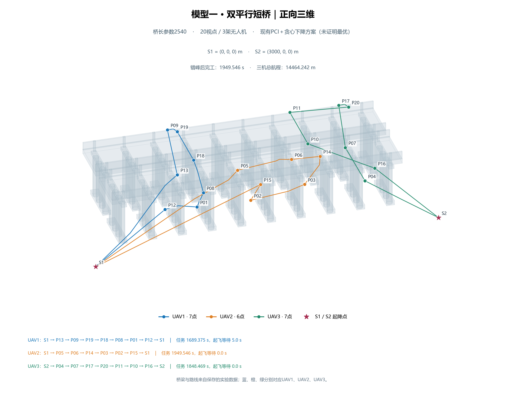
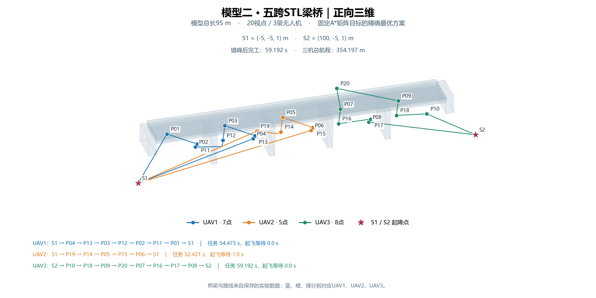
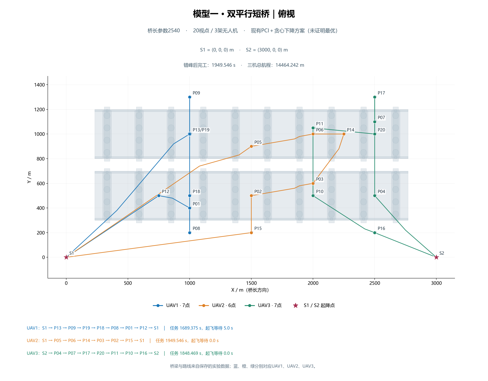
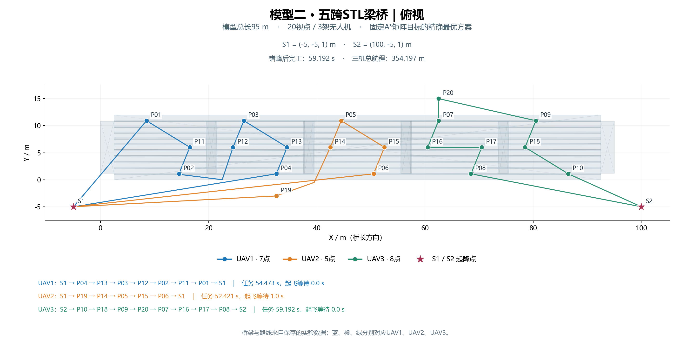

# 历史实验展示图

本目录保留原交付包的双桥、STL 梁桥多视角图片，未修改原图内容。

部分图上的“固定 A* 矩阵目标的精确最优方案”及航程数值与当前 `数据集/运行结果/` 中的 `pci_greedy` 结果不完全一致。这些图片用于查看场景和历史展示，不作为当前基线的优化性证明或量化结果。

当前结果以 `数据集/运行结果/*/plan.json`、`online_simulation.json` 和同目录 `preview.png` 为准，汇总见 [项目首页](../README.md) 与 [验证说明](../docs/VALIDATION.md)。

| 双桥历史展示 | STL 梁桥历史展示 |
| --- | --- |
|  |  |
|  |  |
